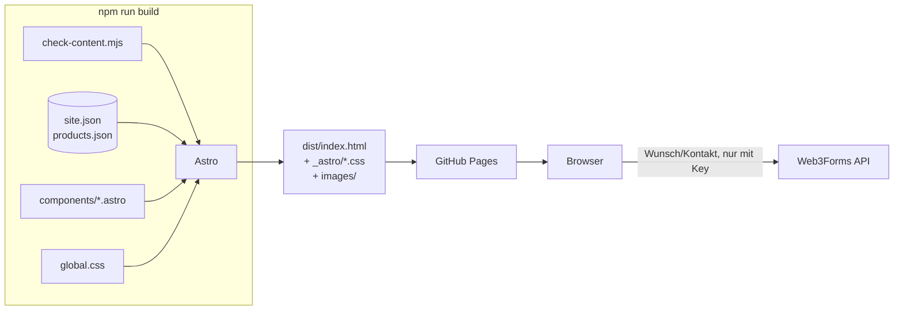

# Architektur

Stand: 2026-10-29

## Überblick

Drei statische HTML-Seiten (Startseite, Impressum, Datenschutz), zur Build-Zeit von Astro aus einem Layout, Komponenten und zwei JSON-Dateien erzeugt.
Kein Server, keine Datenbank, kein UI-Framework. Das ausgelieferte JavaScript besteht aus zwei kleinen Inline-Skripten.

Entscheidungen dahinter: [ADR 0001](decisions/0001-astro-statisch-auf-github-pages.md), [ADR 0002](decisions/0002-formulare-web3forms-und-demo-modus.md), [ADR 0004](decisions/0004-rechtstexte-und-schriften.md).

## Seiten und Layout

| Seite | Datei | Inhalt | robots |
|---|---|---|---|
| `/` | `src/pages/index.astro` | Landingpage (Sektionen unten) | index |
| `/impressum/` | `src/pages/impressum.astro` | Impressum aus `site.json → legal` | noindex |
| `/datenschutz/` | `src/pages/datenschutz.astro` | Datenschutzerklärung; Formular-Abschnitt hängt an `PUBLIC_WEB3FORMS_KEY` | noindex |

Alle Seiten nutzen `src/layouts/Base.astro`: `<head>` mit SEO/OG/canonical, Skip-Link, Import der selbst gehosteten Schriften (Source Sans 3, Gelasio via `@fontsource`, nur `latin`) und von `global.css`. Header und Footer erscheinen auf allen Seiten, ihre Anker sind deshalb mit `base` präfixiert.

## Startseite

Reihenfolge festgelegt in [`src/pages/index.astro`](../src/pages/index.astro):

| # | Komponente | Anker | Inhalt | Daten |
|---|---|---|---|---|
| 1 | `Header` | – | Sticky Pill-Navigation, Vinted-/Bewertungs-Link, Impressum | `site.json → links, review` |
| 2 | `Hero` | `#top` | Headline, CTAs, Bild-Mosaik, rotierendes „Preloved“-Siegel | – |
| 3 | `Products` | `#angebote` | „Finde deine Farbwelt“ mit Farbwelten-Filter | `products.json`, `fresh: false` |
| 4 | `Sell` | `#verkaufen` | Ankauf und Kommission, 3-Schritte-Erklärung | – |
| 5 | `Products` | `#drops` | „Fresh Drops“ | `products.json`, `fresh: true` |
| 6 | `Thursday` | `#wunsch` | Suchtag-Banner, Wunschstück-CTA | `site.json → links` |
| 7 | `About` | `#ueber` | Über Nele und Kate, Social-Pills | `site.json → links` |
| 8 | `Footer` | – | Navigation, Social, Impressum/Datenschutz, Hinweise (Demo, „geprüft“, Marken, ggf. Bewertungen) | `site.json`, `products.json` |
| – | `Assistant` | – | Schwebender Button + 4 Modals | `site.json → links`, `PUBLIC_WEB3FORMS_KEY` |

`Products` ist zweimal eingebunden und wird über Props gesteuert (`over`, `title`, `titleSer`, `products`, `showWorlds`). Unter jedem Raster steht die Preis-Fußnote (PAngV), abhängig von `legal.smallBusiness`.

## Client-JavaScript

### `index.astro` (gebündelt von Astro)
- **Scroll-Reveal:** `IntersectionObserver` setzt `.in` auf alle `.rv`-Elemente.
- **Farbwelten-Filter:** Klick auf `.world` blendet `.card` mit anderem `data-world` aus und zeigt bei leerem Grid einen Hinweis.
  Wirkt auf **alle** `.grid`-Elemente, also auch auf Fresh Drops (siehe [Roadmap](roadmap.md), technische Schulden).

### `Assistant.astro` (Inline-Skript mit `define:vars`)
- **Modals:** `assist` (Auswahl), `sell`, `wish`, `contact`. Öffnen per `data-open="KEY"`, Schließen per `data-close`, Escape oder Klick auf den Hintergrund. Fokus-Falle und Fokus-Rückgabe zentral.
- **Produktkontext:** Ein Klick auf eine Karte merkt sich `data-prod`. Assistent und Kontakt zeigen „Es geht um: …“ mit Kopier-Button.
- **Foto-Upload (nur Vorschau):** bis 6 Bilder, je max. 8 MB, JPG/PNG/WebP/HEIC, Drag & Drop, Vorschau per `URL.createObjectURL`.
- **Validierung:** `markBad()` pro Feld, E-Mail per Regex.

## Formulare

| Formular | Felder | Versand |
|---|---|---|
| Kontakt | Nachricht, E-Mail (+ Artikel aus Kontext) | Web3Forms, wenn `PUBLIC_WEB3FORMS_KEY` gesetzt – sonst Demo |
| Wunschstück | Marke, Kategorie, Größe, Farbe, Budget, E-Mail | Web3Forms, wenn Key gesetzt – sonst Demo |
| Verkaufen | Verkaufsart, Marke/Artikel, Größe, Zustand, Wunschpreis, Fotos, Hinweise, E-Mail, Einwilligung | **immer Demo** – Upload-Backend fehlt |

`LIVE = !!W3F_KEY` entscheidet zur Build-Zeit. Ohne Key bleibt der Hinweis „Prototyp-Hinweis …“ sichtbar und die Erfolgsmeldung sagt ehrlich, dass nichts übertragen wurde.

## Styling

Alles in [`src/styles/global.css`](../src/styles/global.css), global importiert. Keine scoped Styles in Komponenten.
Tokens, Typografie und Muster: [Rule `design-system`](../.claude/rules/design-system.md).

## Pfade und URLs

- `src/lib/url.ts` exportiert `base` (immer mit End-Slash) und `asset(p)`.
- `astro.config.mjs` liest `SITE` und `BASE_PATH` aus der Umgebung – Details in [deployment.md](deployment.md).
- `<head>`: canonical, `og:url`, `og:image` als absolute URLs; JSON-LD `Organization` mit `sameAs` = alle Social-Links.

## Qualitätssicherung

- `scripts/check-content.mjs` validiert `products.json` und `site.json` vor jedem Build (Pflichtfelder, erlaubte Werte, Bild existiert, https-Links, Bewertung vollständig, Impressumsdaten). Fehlende E-Mail/Telefon im Impressum: Warnung (in GitHub Actions als Annotation).
- `ci.yml` baut jeden Pull Request, `deploy.yml` baut und deployt `main`.
- Dependabot: npm wöchentlich, GitHub Actions monatlich.
