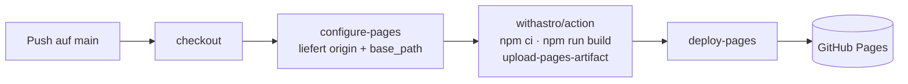

# Deployment

Stand: 2026-10-29

- **Live:** <https://teifler.github.io/eskadronverkauf/>
- **Hosting:** GitHub Pages, Quelle „GitHub Actions“
- **Auslöser:** jeder Push auf `main` und manuell („Actions“ → „Deploy auf GitHub Pages“ → „Run workflow“)

## Ablauf

[`deploy.yml`](../.github/workflows/deploy.yml): Job `build` (Node 22) und Job `deploy` (Umgebung `github-pages`).
Es läuft immer nur ein Deploy. Ein laufender wird nicht abgebrochen, dazwischen eingereihte werden übersprungen.

Pull Requests baut [`ci.yml`](../.github/workflows/ci.yml) nur, ohne Deploy.

## Umgebungsvariablen

| Variable | Woher | Wirkung | Lokal-Fallback |
|---|---|---|---|
| `SITE` | `configure-pages` → `origin` | Domain für canonical, OG, JSON-LD | `https://teifler.github.io` |
| `BASE_PATH` | `configure-pages` → `base_path` (leer → `/`) | Unterordner aller Pfade | `/eskadronverkauf` |
| `PUBLIC_WEB3FORMS_KEY` | Repo-Variable | Kontakt- und Wunschformular senden echt | leer → Demo-Modus |

Lokal lassen sich alle drei in `.env` setzen (git-ignoriert) oder vor den Befehl schreiben.

### Web3Forms-Key setzen

> **Vorher lesen:** Web3Forms ist datenschutzrechtlich heikel (Betreiber in Indien ohne Angemessenheitsbeschluss, US-Spamfilter erhalten IP und E-Mail) – siehe [ADR 0004](decisions/0004-rechtstexte-und-schriften.md). Sobald der Key gesetzt ist, erscheint der Web3Forms-Abschnitt automatisch in der Datenschutzerklärung.

1. Kostenlosen Access Key auf <https://web3forms.com> für die Ziel-E-Mail-Adresse erzeugen.
2. Repo → Settings → Secrets and variables → Actions → **Variables** → `PUBLIC_WEB3FORMS_KEY`.
   Oder: `gh variable set PUBLIC_WEB3FORMS_KEY --repo teifler/eskadronverkauf`
3. Deploy neu starten (`gh workflow run deploy.yml`). Der Demo-Hinweis verschwindet aus beiden Formularen.

Warum Variable statt Secret: Der Key steht zwingend im ausgelieferten HTML. Ein Secret würde Schutz vortäuschen. Gegen Spam vor dem Live-Schalten einen Honeypot (`botcheck`) ergänzen – siehe Issue #4.

## Eigene Domain (z. B. eskadronverkauf.de)

1. DNS beim Domain-Anbieter:
   - Apex-Domain: `A`-Records auf `185.199.108.153`, `185.199.109.153`, `185.199.110.153`, `185.199.111.153` (und optional `AAAA` `2606:50c0:8000::153` … `8003::153`)
   - `www`: `CNAME` auf `teifler.github.io`
2. Domain zuerst im GitHub-Profil verifizieren (Profil-Settings → Pages → „Add a domain“, schützt vor Domain-Übernahme), dann im Repo unter Settings → Pages → „Custom domain“ eintragen und **Enforce HTTPS** aktivieren, sobald das Zertifikat da ist.
3. Deploy neu starten. `configure-pages` liefert dann die neue Domain und einen leeren `base_path` – der Workflow übergibt `/`. **Keine Code-Änderung nötig.**
4. `AGENTS.md`, `README.md`, Skill `ship` und diese Datei auf die neue URL umstellen. Web3Forms-Domain anpassen.

Eine `CNAME`-Datei in `public/` braucht es beim Actions-Deploy nicht.

## Rollback

- **Schnell:** `git revert <commit>` und pushen – der Deploy stellt den alten Stand her.
- **Ohne neuen Commit:** In „Actions“ einen älteren erfolgreichen Run von „Deploy auf GitHub Pages“ öffnen → „Re-run all jobs“. Er deployt den damaligen Commit.

## Fehlerbilder

| Symptom | Ursache | Lösung |
|---|---|---|
| Seite lädt, Bilder/CSS 404 | Pfad ohne `asset()` oder falscher `BASE_PATH` | Rule `base-path`; `npm run build && npm run preview` lokal prüfen |
| Build rot: „Inhaltsprüfung fehlgeschlagen“ | Fehler in `products.json`/`site.json` | Meldung im Log lesen, Feld korrigieren |
| Deploy rot: „Get Pages site failed“ / 404 | Pages nicht auf „GitHub Actions“ gestellt | Settings → Pages → Source: GitHub Actions |
| Alte Version sichtbar | Pages-CDN-Cache (bis ca. 10 min) | Warten, hart neu laden |
| Formulare im Demo-Modus trotz Key | Variable als *Secret* statt *Variable* angelegt oder kein neuer Deploy | Als Variable anlegen, Deploy neu starten |
